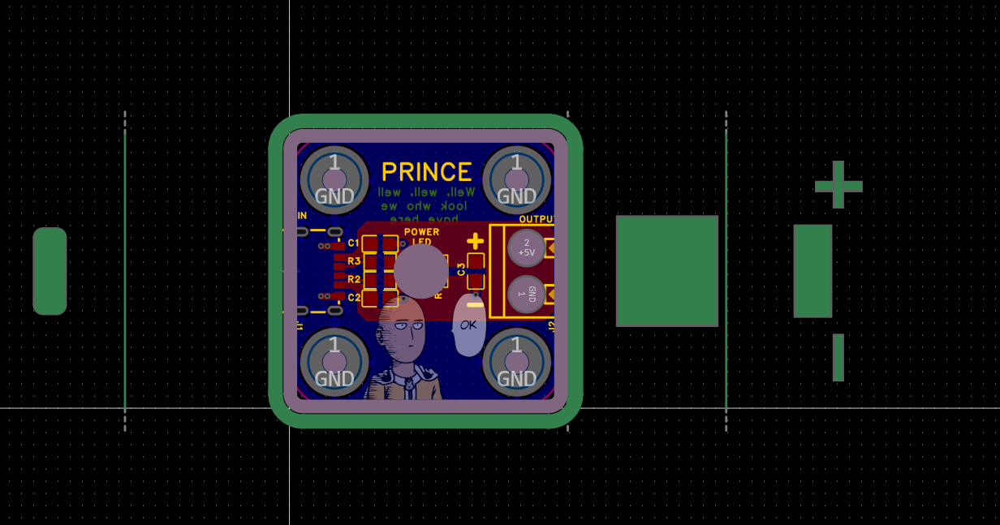
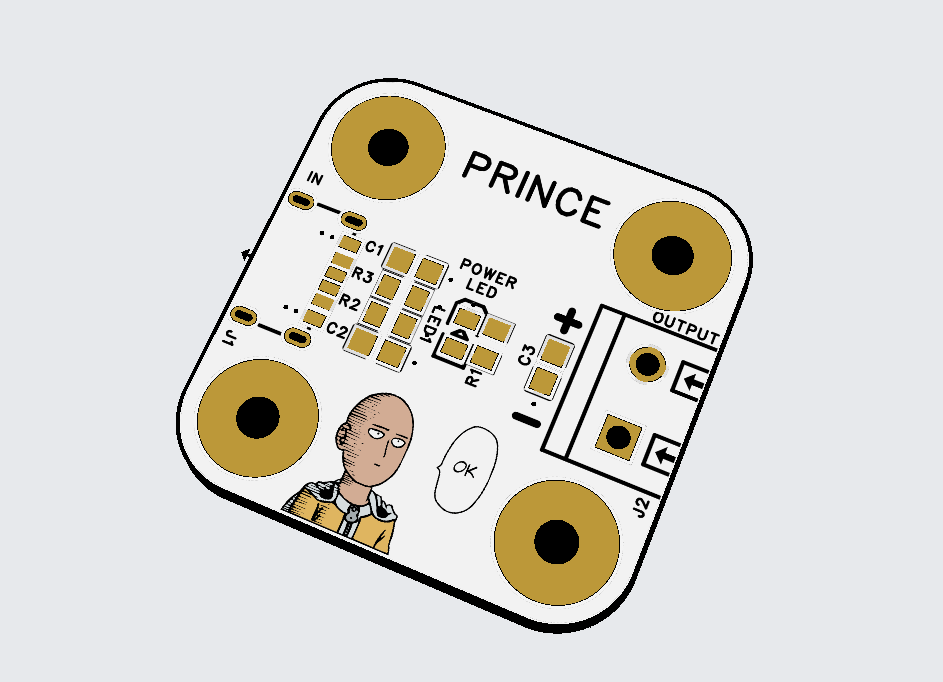
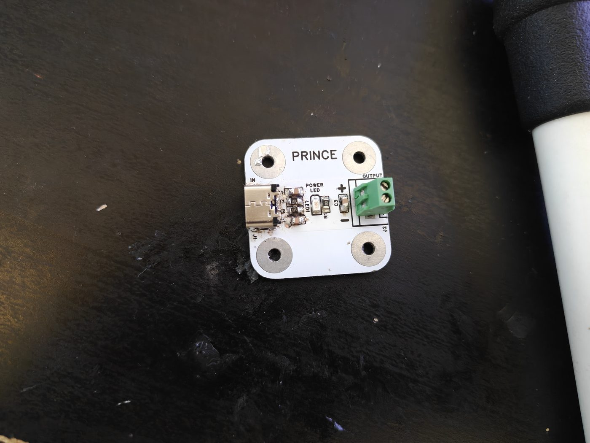
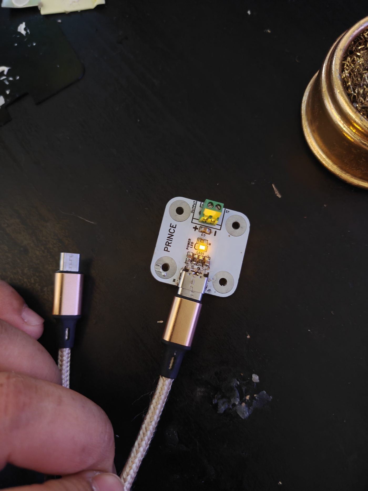
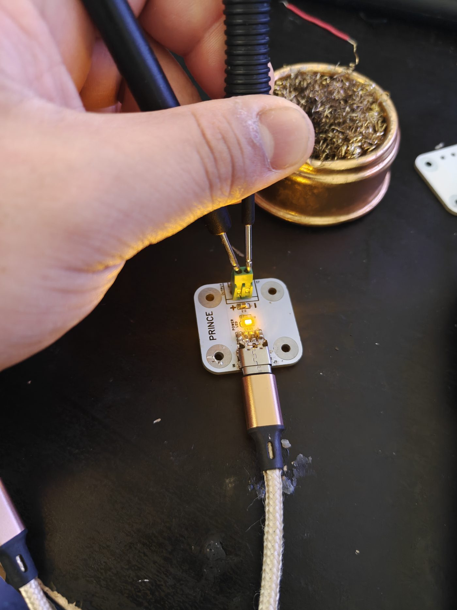
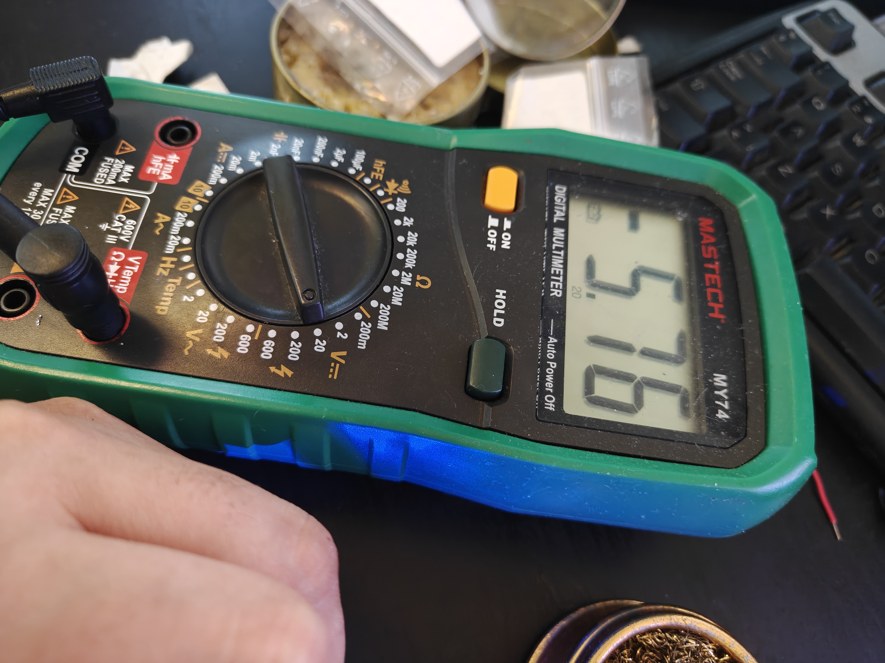
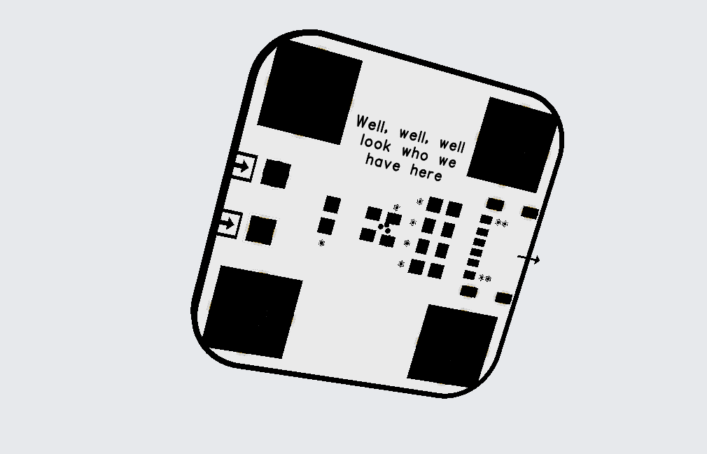
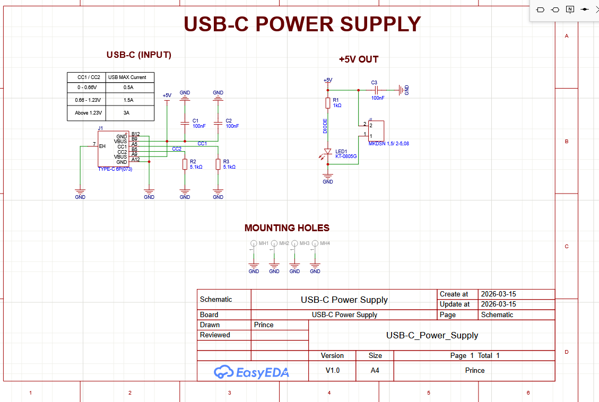

<h1 align="center">One Power Supply</h1>

USB-C Power Supply PCB Design

---

## Overview

  
  

  

---

## Result — Built & Tested

The board was fabricated, hand-soldered and tested.

  
  

  <em>Soldered board (USB-C IN, screw-terminal OUTPUT, power LED) — powered up, power LED lit.</em>

Output voltage measured at the screw terminal with a multimeter — **5.10 V DC**:

  
  

---

## 3D + Enclosure

  

  
  

---

## Design Details

  
  

  
  

---

## Files Included

* Gerber files (Colour & No Colour)
* BOM (Bill of Materials)
* Pick and Place file
* 3D PCB + Shell design
* Altium design outputs
* Build photos and test results (`Result/`)

---

