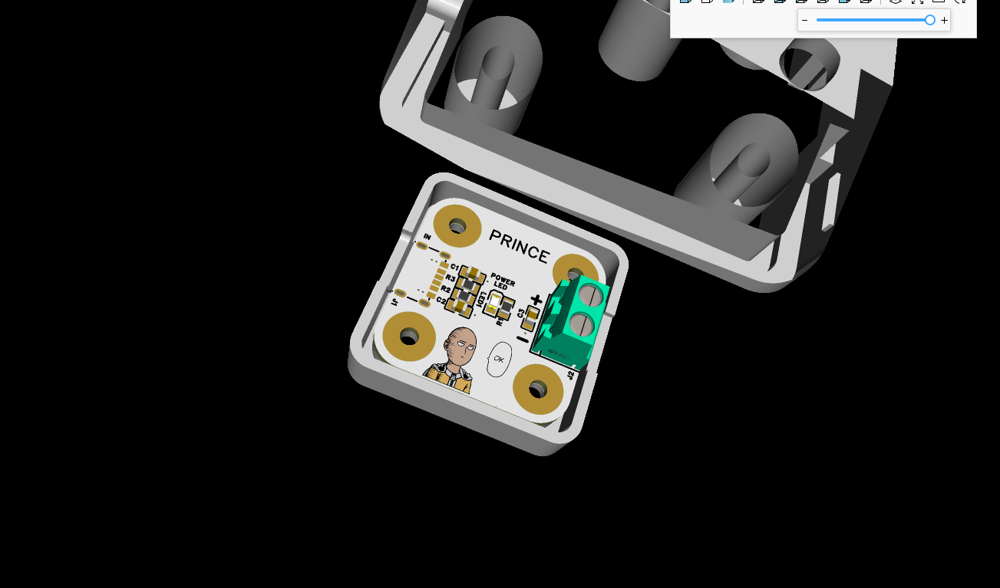
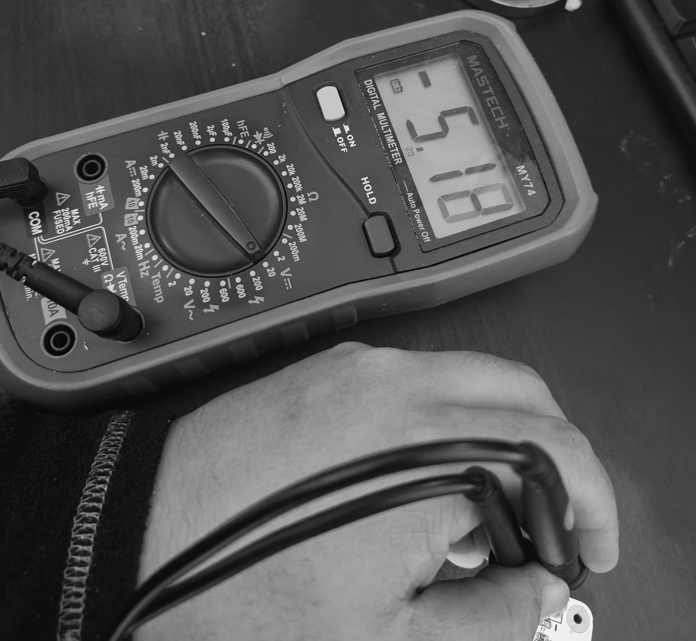

# One Power Supply

A small PCB that takes power from a USB C source and brings it out to a screw terminal.

The board was designed in EasyEDA, ordered from JLCPCB, hand soldered and tested at home.
It is a 2 layer board with **no active components**. Every part on it is a connector, a
capacitor, a resistor or an LED.




---

## What is this

A USB C source puts 5 V on the VBUS pins. This board connects those pins straight to a 2 pin
screw terminal, so a device can be powered from any USB C source without cutting a cable open.

Two 5.1 kOhm resistors sit on CC1 and CC2. They tell the source that a device is attached,
which is how a USB C source decides to turn its 5 V on in the first place.

Three 100 nF capacitors filter the supply, and one 1 kOhm resistor with an LED shows when
power is present on the input.

There is **no regulator on this board**. The output voltage is the source voltage. That is
written here plainly because it decides what the board can and cannot be used for.

---

## Specification

| Item | Value |
|---|---|
| Input | USB C receptacle, 6 pin |
| Output | 2 pin screw terminal, 5.08 mm pitch |
| Board layers | 2 |
| CC pull down | 5.1 kOhm on CC1 and CC2 |
| Input filtering | 2 x 100 nF |
| Output filtering | 1 x 100 nF |
| Power indicator | LED with 1 kOhm series resistor |
| Mounting | 4 holes to ground |
| Regulator | none |
| Output voltage | follows the input source |
| Measured output | 5.18 V at the screw terminal |

---

## Design

**Schematic.** One sheet. The USB C receptacle J1 has all four VBUS pins (A4, A9, B4, B9)
joined to a single +5V net. GND pins A1 and B12 and the shell pin EH go to ground. CC1 and
CC2 each have a 5.1 kOhm resistor to ground. Two 100 nF capacitors sit between +5V and
ground. The +5V net goes to pin 1 of the screw terminal J2, and pin 2 of J2 goes to ground
along with a third 100 nF capacitor.

**Layout.** 2 layer, top copper and bottom copper, with plated through holes. All parts except
the screw terminal are surface mount on the top side. The USB C receptacle sits on one edge and
the screw terminal on the opposite edge. Four mounting holes are placed at the corners and tied
to ground. The silkscreen carries the board name, the pin labels IN and OUT, and a small drawing.

**Enclosure.** The 3D shell design is included as STL files, so the board can be closed in a
printed box with an opening for the USB C plug and the LED.

**Fabrication data.** Full Gerber set, drill files, bill of materials and pick and place file
are in this repository. Two Gerber variants are included, one with a colour silkscreen and
one without.

---

## Making and testing

The Gerbers were ordered from JLCPCB, the board came back bare, and every part was soldered
by hand.

Test method: board powered from a USB C source, multimeter probe on the screw terminal.

Result: **5.18 V** at the output terminal.



5.18 V sits inside the 4.75 to 5.25 V USB tolerance, so the board does what it is meant to do
with the source I used. Because there is no regulator, the exact value depends on the charger
and on the load, and a heavier load will pull it down.

---

## Limitations

- **No regulation.** The output moves with the charger and with the load. A load that pulls
  real current will see the voltage fall.
- **Almost no bulk capacitance.** 100 nF is a decoupling value, not a reservoir. A device
  that draws current in bursts will see the supply sag.
- **No protection.** There is no fuse, no TVS diode and no reverse polarity protection. A
  short on the output goes straight back to the source.
- **3 A is the connector and cable rating**, not something this board enforces. The board
  does not limit current and does not protect against overload.
- **USB C data lines are not connected.** This is a power board only.

---

## What I would change in a second revision

1. Add a 5 V LDO or a small buck converter so the output is regulated.
2. Add 10 uF of ceramic bulk capacitance on input and output.
3. Add a fuse on the output path.
4. Add test points for output voltage and ground.
5. Add a reverse polarity or ESD protection diode on the input.

---

## Files

```
One-Power-Supply/
├── README.md
├── BOM_USB-C Power Supply_PCB_2026-03-15.xlsx       bill of materials
├── PickAndPlace_PCB_2026-03-15.xlsx                 pick and place
├── Gerber_PCB_2026-03-15 No Colour/                 fabrication files, plain
├── Gerber_PCB_2026-03-15_Colour/                    fabrication files, colour silk
├── 3DShell_PCB/                                     enclosure, STL files
├── SCH.png                                          schematic
├── PCB.png                                          PCB layout
├── 3dpcbfront.png                                   front 3D view
├── 3dpcbback2.png                                   back 3D view
└── Result/
    ├── web/
    │   ├── soldered-board.jpg                       the finished board
    │   └── measuring2.jpg                           output voltage measurement
    └── board soldered.jpg, board pluggedin.jpg …    full size originals
```

## Tools used

EasyEDA for schematic capture and PCB layout. JLCPCB for fabrication. A multimeter for the
output measurement.

---

**Author:** Prince Khand Thakuri
